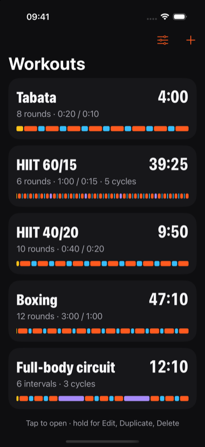
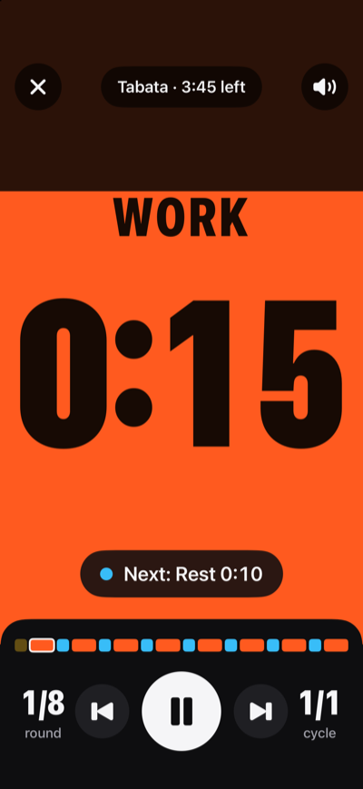
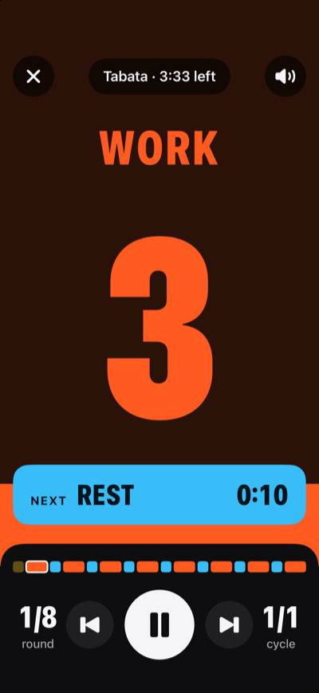
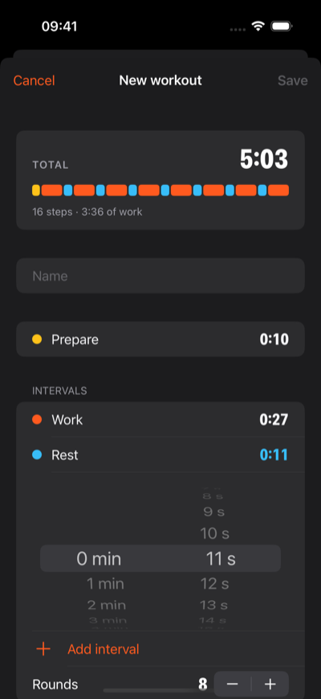
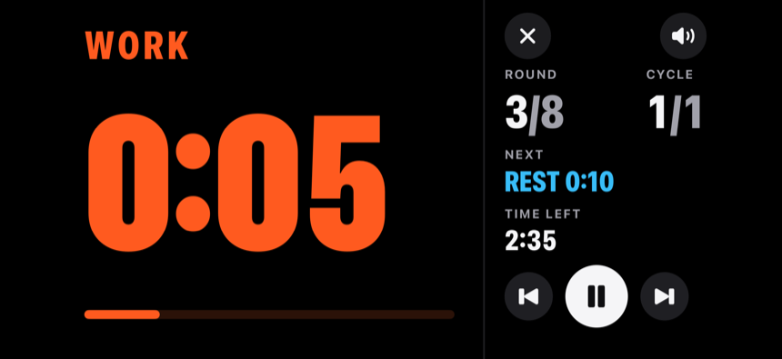
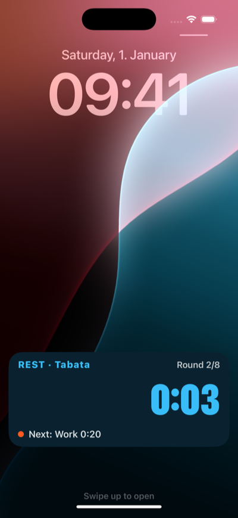

# Ritmo

A simple interval timer for iPhone, made for the gym: free, no account, no ads, no tracking, works offline.

Ritmo replaces an interval timer that, after years of use, started asking for a paid licence just to start a workout.

<p>
  
  
  
  
</p>
<p>
  
  
</p>

## What it does

- **Workouts the way gyms count them.** A Prepare phase, then work and rest intervals repeated for a number of *rounds*. The rounds can repeat for several *cycles*, with a longer rest between cycles. The last rest before a cycle rest, or before the end, is skipped.
- **A timer you can read from across the room.** In portrait, the colour of the phase fills the screen and drains like a tide, and the digits change colour where the level crosses them. In landscape it becomes a scoreboard.
- **Cues you can hear.** A beep at 3, 2 and 1 seconds, then a voice reads the new phase: "Prepare", "Work", "Rest", "Recover". The cues play over your music, which gets quieter while they play, and the phone vibrates at every change.
- **Works with the phone locked**, and shows the countdown on the lock screen and in the Dynamic Island.
- **Workouts you can share** as `.ritmo` files, by AirDrop, Messages or Files. Opening one on an iPhone with Ritmo adds its workouts.

It comes with Tabata, HIIT 60/15, HIIT 40/20, Boxing and a full-body circuit, all editable.

## How the timer works

These rules are the same on every platform, and the tests check them.

**Steps.** Before it starts, a workout becomes a list of steps: Prepare, if it lasts more than 0 seconds; then, for each cycle, the intervals of every round; then a Recover step between one cycle and the next, if there is a rest between cycles. A Rest followed directly by a Recover or by the end of the workout is dropped. The total time is the sum of the steps.

**The clock.** Time is computed from when the workout started and from its pauses, not by counting ticks, so it doesn't drift, not even with the screen locked. The digits round up: a 20-second step shows 0:20 at the start and 0:01 in its last second. Times read m:ss ("0:09", "12:00"), or h:mm:ss beyond an hour.

**Controls.** Pause and resume; next; previous, which restarts the step after its first 2 seconds and otherwise goes back to the step before; sound on and off; and end, by holding the X once the workout has started. A phone call pauses the timer, and the screen stays on from the first Play to the end.

**Cues.**

| When | What happens |
|---|---|
| The last 3 seconds of every step | a short beep each second: 3, 2, 1 |
| The start of every step | a voice reads its name ("Prepare", "Work", "Rest", "Recover", or "Burpees" if you named it so) and the phone vibrates |
| The end | the voice says "Workout complete" and the phone vibrates |

With the voice off, a long beep takes the place of the name. The beeps are tones generated by the app.

Each phase has its colour: Prepare amber `#FFC21A`, Work orange `#FF5A1F`, Rest blue `#38BDF8`, Recover violet `#A78BFA`.

## Install it on your iPhone

Ritmo isn't on the App Store, but you can build it with a free Apple ID:

1. Install Xcode (Ritmo is built with Xcode 27.2), open `Ritmo.xcodeproj` and add your Apple ID in Xcode → Settings → Apple Accounts.
2. Create `Config/Local.xcconfig` with your team and a prefix for the app's identifier, as `Config/Signing.xcconfig` explains. That file stays out of git.
3. Connect the iPhone, turn on Developer Mode in Settings → Privacy & Security, and press Run.
4. The first time, trust the developer on the iPhone, in Settings → General → VPN & Device Management.

With a free Apple ID the signature lasts 7 days, so press Run again once a week; your workouts stay on the phone. While the week's signature is valid, `./install.sh` reinstalls the app from the terminal.

To install it without Xcode, `./ipa.sh` builds an unsigned `build/Ritmo.ipa` for SideStore, AltStore or Sideloadly, which sign it with the Apple ID of whoever installs it. `./ipa.sh --signed` builds `build/Ritmo-signed.ipa`, signed with your own team for your own iPhone, to install with Apple Configurator; that file contains your Apple ID, so keep it to yourself.

## The `.ritmo` format

It's JSON, so it can be written by hand; missing ids are created on import.

```json
{
  "format": "ritmo",
  "version": 1,
  "workouts": [
    {
      "name": "HIIT 60/15",
      "prepare": 10,
      "intervals": [
        { "kind": "work", "name": "Work", "seconds": 60 },
        { "kind": "rest", "name": "Rest", "seconds": 15 }
      ],
      "rounds": 6,
      "cycles": 5,
      "cycleRest": 45
    }
  ]
}
```

This one is in [examples](examples/HIIT%2060-15.ritmo).

## Code

SwiftUI, iOS 17 or later, no dependencies.

| Folder | What's inside |
|---|---|
| `Ritmo/Core` | workouts, steps, the clock, the cues and the `.ritmo` format, without UIKit; covered by tests |
| `Ritmo/Audio` | audio session, beeps, voice and vibration |
| `Ritmo/Views` | the list, the editor, the timer (tide and scoreboard) and settings |
| `RitmoLive` | the Live Activity for the lock screen and the Dynamic Island |
| `Shared` | phase colours and Live Activity data, used by the app and by RitmoLive |
| `Tests` | tests for `Ritmo/Core` |

Run the tests on a Mac with `swift test`; `Package.swift` exists only for that.
